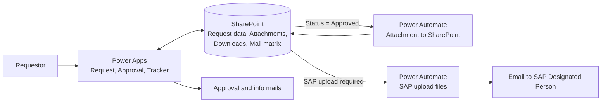
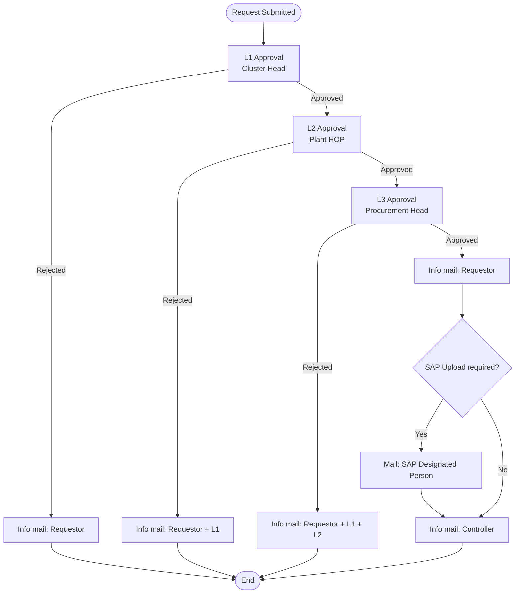
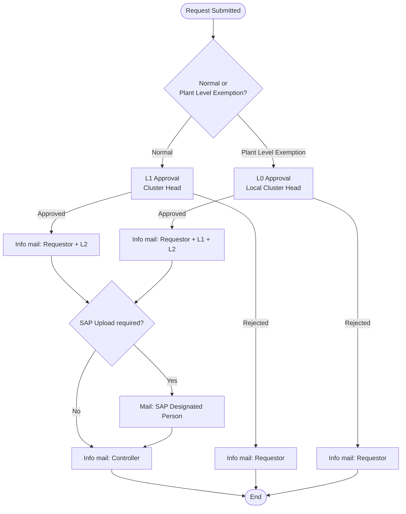

# Procurement Approval System

A multi-level approval system for procurement price-change and purchase
requests, built with Power Apps, SharePoint and Power Automate.

> Built at work for a procurement team.
> This repository contains no company data. Names, plants, emails and
> values are generic or dummy.

## Problem
Price-change approvals were handled over email and Excel, with no
tracking, no fixed approval chain and no record of who approved what.

## Solution
- Request submission with an attached Excel file
- Automatic routing by contract type (Contractual / Non-Contractual)
- Plant Level Exemption path
- Approval and rejection mails at each stage
- Request tracker, plus SAP upload support after final approval

## Architecture

## Tech Stack
| Tool | Role |
|---|---|
| Power Apps | Request Submission, Approval screens, Request Tracker, SAP Upload confirmation; routing, status updates and mails coded in the app |
| SharePoint | Request data, Attachment content, Downloads, Mail matrix |
| Power Automate | Moves approved attachment content into SharePoint; builds SAP Upload files and emails them |

## Approval Flows

### Non-Contractual (3 levels)

### Contractual (1 level, with Plant Level Exemption)

The exemption path is chosen automatically from pre-configured
plant and commodity combinations.

## Code Snippets
Sanitised Power Apps logic, with links, IDs and names removed:

- [Submit button](code-snippets/submit-button.md): validation, approver
  lookup, request creation and the first approval mail
- [Approve button (L0/L1)](code-snippets/approve-button-l0-l1.md):
  rejection, final approval for Contractual requests, and routing
  Non-Contractual requests to the next level

The L2 and L3 approval buttons follow the same pattern as the L0/L1
button: they update that level's status, comments and date, then either
notify the next approver or send the final approval mail.

For More Details:
- [Power Automate flows](power-automate-flows.md)
- [SharePoint structure](sharepoint-structure.md)
