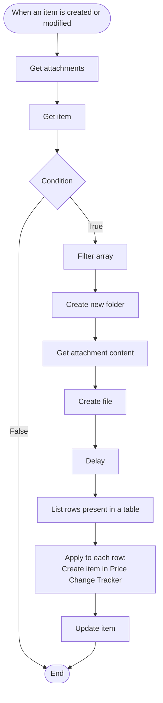
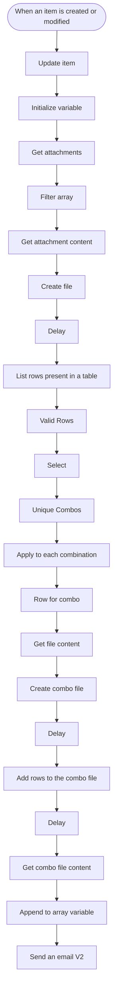

# Power Automate Flows

Two flows run on the Request Tracker list in SharePoint.

## 1. Attachment Content Flow
Runs when an item is created or modified. It saves the request's
attachment into a SharePoint folder and loads its data into the
Price Change Tracker.

1. **Trigger:** a request item is modified where a status is marked as Approved.
2. **Get attachments and Get item:** reads the request's attachments and its details.
3. **Condition:** the remaining steps run only when it is true.
4. **Filter array:** picks the correct attachment from the list.
5. **Create new folder, Get attachment content, Create file:** stores the file in its own SharePoint folder.
6. **Delay:** gives SharePoint time to finish saving the file before it is read.
7. **List rows present in a table:** reads the table inside the Excel file.
8. **Apply to each:** creates one Price Change Tracker item per row.
9. **Update item:** updates the request item after the rows are loaded.

## 2. SAP Upload File Flow
Builds the upload files for SAP and emails them to the SAP Designated
Person.

**Trigger condition:** the flow runs only when Status is Approved, SAP
Upload Required is Yes, and SAP Email Sent is false.

1. **Trigger and Update item:** a request item is created or modified.
   The first step sets SAP Email Sent to Yes, so the flow can't run
   twice for the same request.
2. **Initialize variable:** creates an array to collect the generated files.
3. **Get attachments, Filter array, Get attachment content, Create file:**
   saves the approved Excel file.
4. **Delay and List rows present in a table:** reads the table rows.
5. **Valid Rows, Select, Unique Combos:** keeps only valid rows and
   shapes them. Unique Combos uses `union()` on the selected output,
   which removes duplicates and leaves one entry per combination.
6. **Apply to each combination:** for each one it filters that
   combination's rows, creates a separate upload file, and adds the
   rows to it. Delays between steps let each file finish saving.
7. **Get combo file content and Append to array variable:** collects
   every file for the email.
8. **Send an email (V2):** emails the collected files to the SAP
   Designated Person.
